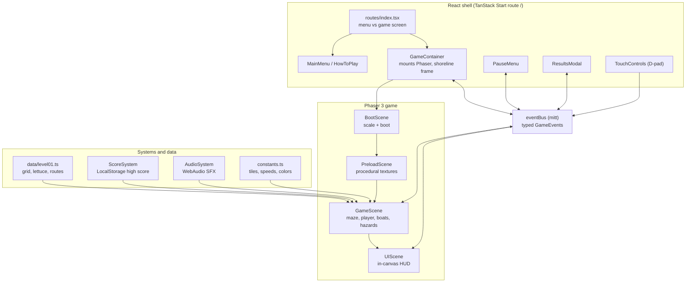
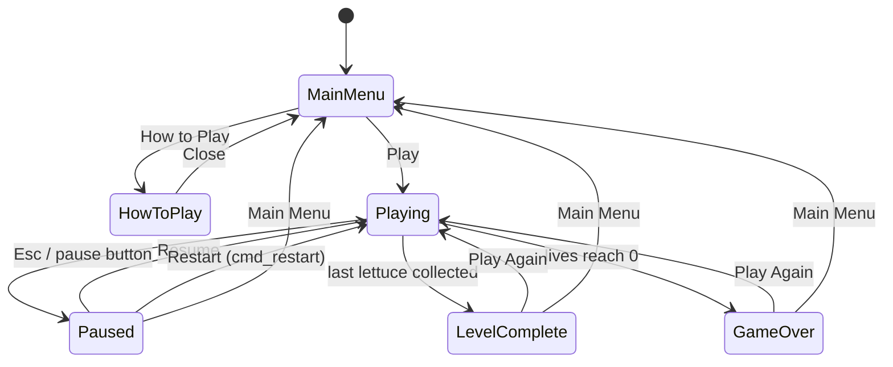
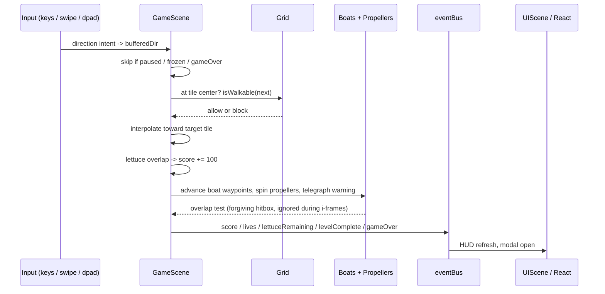
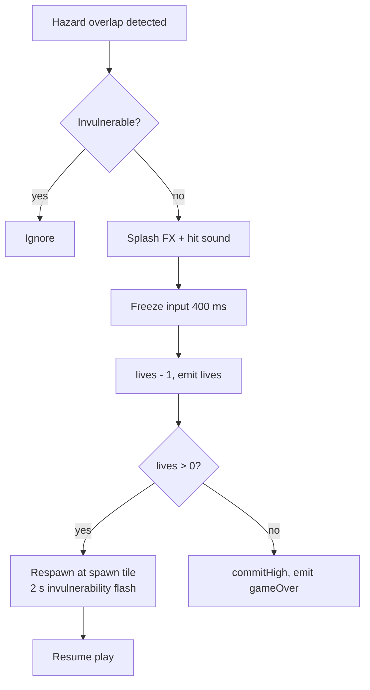

# River Manatee — Game Design Document

A polished top-down arcade maze game built with React 19, TypeScript, TanStack Start (Vite 7), Phaser 3 and Tailwind CSS v4. You swim a friendly Florida manatee through a rope maze, gather floating lettuce, and dodge boats and propellers.


```bash
npm install
npm run dev
```

---

## 1. Design pillars

1. **Calm but tense** — gentle water motion and soft colors, punctuated by boat hazards with clear telegraphing.
2. **Instantly readable** — hazards use icon + shape + motion, never color alone.
3. **Fair arcade rules** — grid movement with input buffering, forgiving hitboxes, invulnerability after a hit.
4. **Zero external assets** — every texture is drawn procedurally at runtime, every sound is synthesized with WebAudio.

## 2. Core loop

Enter maze → steer through corridors → collect lettuce (+100) → avoid boats and propellers → clear all lettuce → level complete bonus → beat the high score.

```text
Lettuce            100 pts each
Level complete   1,000 pts
Remaining life     500 pts each
Lives                  3
Invulnerability    2,000 ms after a hit
Hit freeze           400 ms
```

## 3. World and rules

| System | Rule |
| --- | --- |
| Grid | 25 x 17 tiles, 32 px tiles → 800 x 544 maze, 56 px HUD band, 800 x 600 logical canvas |
| Walls | `rope` tiles (tan rope + buoys); everything else is walkable water |
| Player | Snaps to tile centers, moves at 130 px/s, holds `currentDir` + `bufferedDir` |
| Buffering | At each tile center: apply buffered direction if walkable, else continue current, else stop |
| Boats | 3 waypoint patrols (80 / 95 / 70 px/s) along reserved lanes; blue boat crosses the central corridor and triggers a warning icon + beep before entering |
| Propeller | Rotating blades with a dashed hazard ring; radius ~1.1 tiles |
| Damage | Freeze, splash, −1 life, respawn at spawn, i-frames with flashing alpha |
| Persistence | High score, mute and reduced-motion flags in LocalStorage |


## 4. Controls

- **Keyboard**: Arrow keys or WASD to swim, `Esc` to pause.
- **Touch**: swipe on the canvas, or the translucent on-screen D-pad.
- All inputs normalize to a single direction intent, so no input path can bypass wall checks.

## 5. Technical architecture



**Boundary rule:** all gameplay (movement, collision, hazards, scoring) lives in Phaser. React owns only menus, modals and mounting. The two sides never touch each other's state directly — they exchange events on the bus.

### Event contract

```text
Phaser -> React : score, highScore, lives, lettuceRemaining, lettuceTotal,
                  levelComplete, gameOver, paused, ready
React -> Phaser : cmd_pause, cmd_resume, cmd_restart, cmd_toMenu,
                  cmd_setMuted, cmd_setReducedMotion, cmd_dir
```

## 6. Screen flow



## 7. Frame update order (GameScene.update)



## 8. Damage resolution



## 9. Audio design

`AudioSystem` synthesizes everything with oscillators and noise bursts: pickup blip, boat warning beep, splash on hit, level-complete arpeggio, game-over descent, UI click. It is unlocked on first user gesture and respects the mute flag from LocalStorage.

## 10. Accessibility

- Menus are fully keyboard navigable with visible focus rings.
- Reduced-motion toggle disables wake particles and ripple animation and slows flashing.
- Hazards carry a warning icon and distinct silhouette so they are not color-dependent.
- HUD sits in its own band above the maze and never overlaps a corridor.

## 11. File map

```text
src/
  routes/index.tsx           screen switch + SEO head
  components/                MainMenu, HowToPlay, GameContainer,
                             PauseMenu, ResultsModal, TouchControls
  game/
    config.ts                Phaser game factory (Scale.FIT, 800x600)
    constants.ts             tiles, speeds, scoring, palette, storage keys
    eventBus.ts              typed mitt bridge
    data/level01.ts          procedural grid, lettuce, boat routes, propeller
    data/types.ts            TileType, LevelData, BoatRoute, PropellerSpec
    scenes/                  BootScene, PreloadScene, GameScene, UIScene
    systems/                 ScoreSystem, AudioSystem
```

## 12. Extending

- **New level**: copy `level01.ts`, adjust rope rectangles, lettuce exclusions, boat waypoints and propellers, then load it in `GameScene.create()`.
- **New hazard**: add a spec to `data/types.ts`, spawn it in `GameScene`, and add its overlap test alongside boats and propellers.
- **Real art**: replace the runtime textures in `PreloadScene` with `this.load.image(...)` calls; texture keys stay the same.
- **Tuning**: all balance numbers (speeds, lives, i-frames, scoring) live in `constants.ts`.

## 13. Out of scope (v1)

Multiple levels, pathfinding boat AI, finished art and music, online leaderboards.
