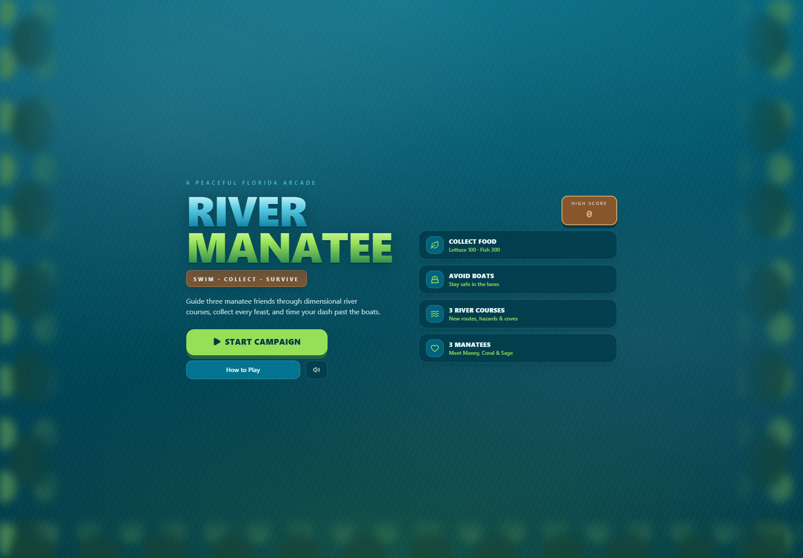
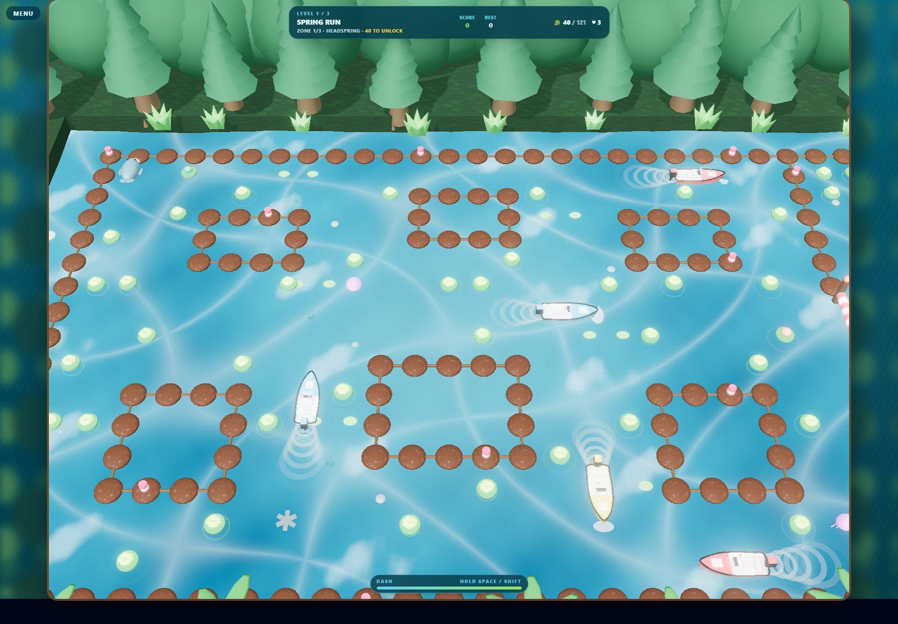
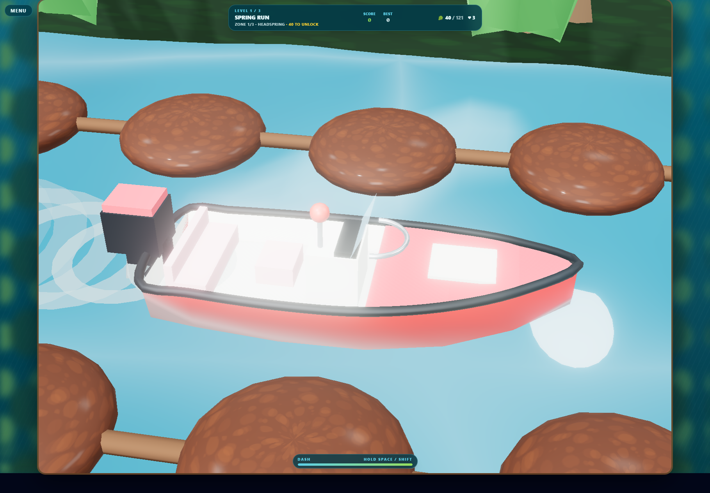
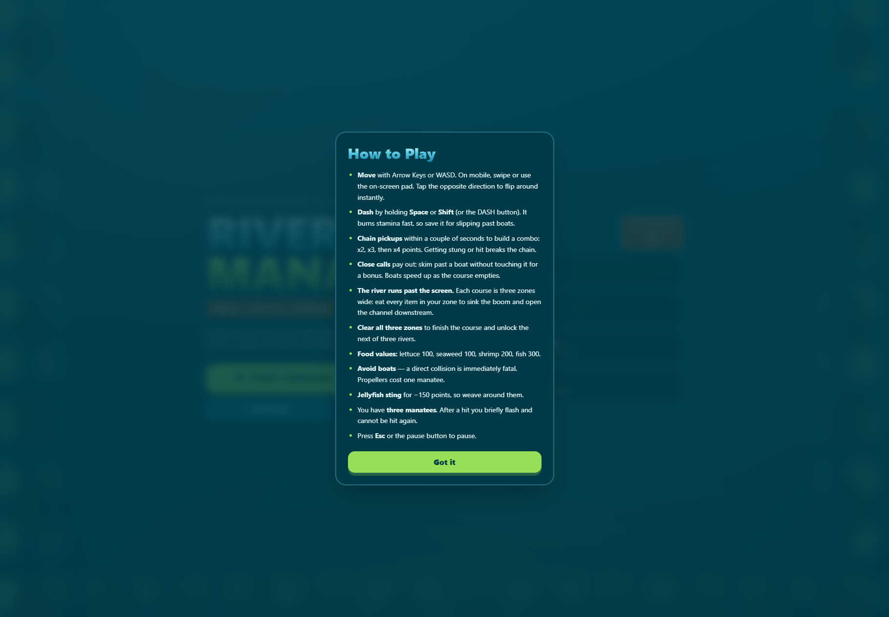
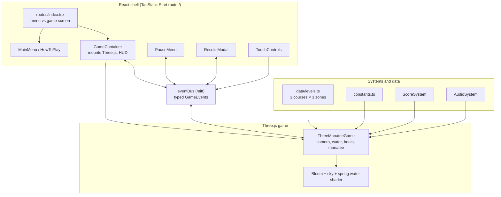
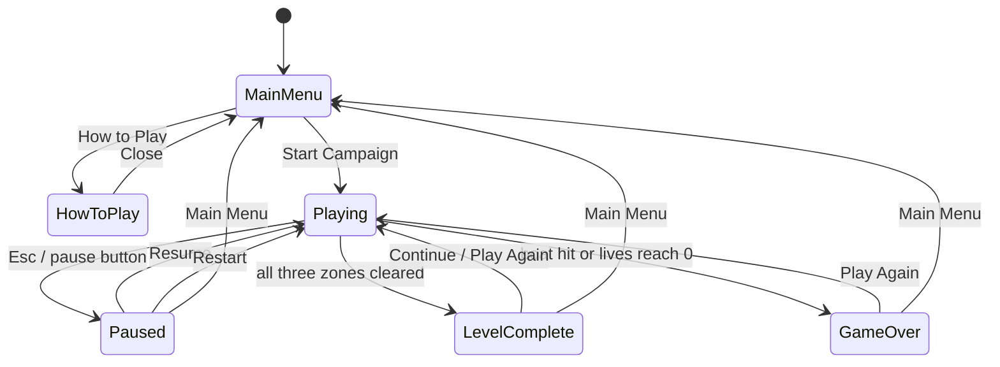
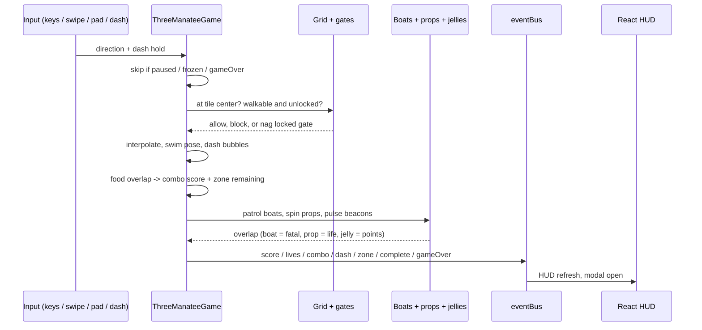
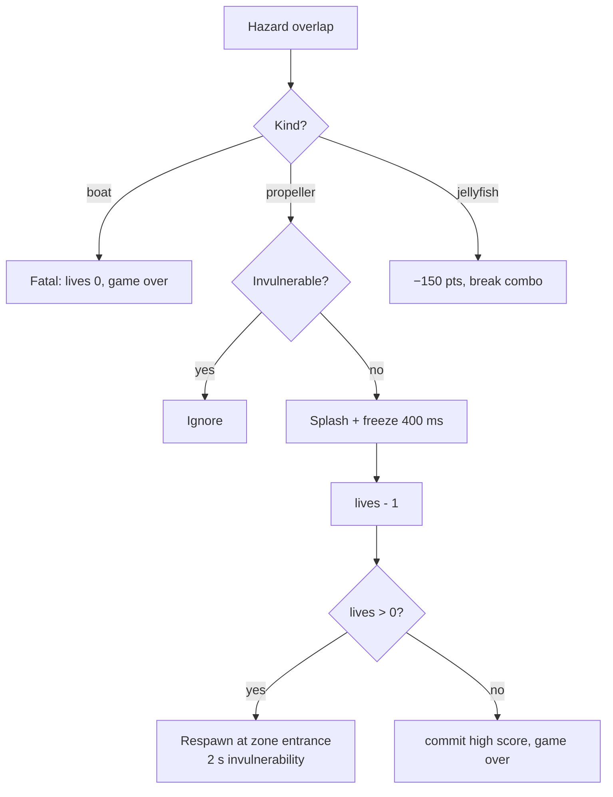

# River Manatee

A 3D Florida-springs arcade game. Swim a manatee through rope channels, feast on floating food, and time your dash past motor boats. Built with React 19, TypeScript, TanStack Start (Vite), Three.js, and Tailwind CSS v4.



```bash
npm install
npm run dev
```

---

## 1. Design pillars

1. **Calm but tense** — cold first-magnitude spring water, mossy forest banks, and clear telegraphing before a boat closes in.
2. **Instantly readable** — hazards use shape + motion + warning lights, never color alone.
3. **Fair arcade rules** — grid movement with input buffering, instant reversals, and a stamina dash for close escapes.
4. **Zero external assets** — hulls, trees, water, and textures are generated at runtime; every sound is synthesized with WebAudio.

## 2. Campaign

Three river courses, each three zones wide. Clear every food item in the current zone to sink the boom and open the channel downstream. Finish all three zones to unlock the next waterway.

| Course | Swimmer | Zones | Feel |
| --- | --- | --- | --- |
| **Spring Run** | Manny | Headspring · Cypress Run · Manatee Cove | First-magnitude spring, dense cypress |
| **Mangrove Bend** | Coral | Mangrove Bend · Root Tangle · Oyster Bar | Tight coves and sheltered turns |
| **Gulf Gauntlet** | Sage | Gulf Gauntlet · Shipping Lane · Open Gulf | Fast lanes out to open water |



## 3. Core loop

Enter the river → steer through rope corridors → collect food (combo if you chain it) → dash past boats → clear the zone to unlock the gate → finish all three zones → course bonus → next river.

```text
Lettuce / seaweed     100 pts
Shrimp                200 pts
Fish                  300 pts
Close-call skim        50 pts × combo
Combo chain            x2 / x3 / x4 if pickups stay within 1.7 s
Jellyfish sting      −150 pts (and breaks combo)
Course complete     1,000 pts
Remaining life        500 pts each
Lives                       3
Invulnerability     2,000 ms after a non-fatal hit
Hit freeze            400 ms
```

## 4. World and rules

| System | Rule |
| --- | --- |
| Grid | Each zone is 25 × 17 tiles. Courses stitch three zones left to right with a locked gate between them. |
| Walls | `rope` tiles (tan line + buoys). `gate` tiles are blocked until that zone is cleared. |
| Player | Snaps to tile centers. Opposite-direction input flips instantly mid-tile. |
| Dash | Hold Space / Shift (or DASH). 1.75× speed, drains stamina at 0.55/s, regenerates at 0.32/s. |
| Boats | Waypoint patrols on reserved lanes. Speed rises as the zone empties (up to +45%). A direct hit is immediately fatal. |
| Close call | Skim a boat without touching it for a bonus popup. |
| Propeller | Rotating blades; costs one manatee. |
| Jellyfish | Sting for −150 and break combo; not lethal. |
| Damage | Boat → game over. Propeller / other hits → freeze, splash, −1 life, respawn at the current zone entrance, i-frames. |
| Persistence | High score, mute, and reduced-motion flags in LocalStorage. |



Boats are small planing runabouts: V-hull, colored foredeck, open cockpit, windshield, and an outboard on the transom.

## 5. Controls



- **Keyboard**: Arrow keys or WASD to swim. Space or Shift to dash. Esc to pause.
- **Touch**: swipe on the canvas, or the on-screen pad plus DASH.
- All inputs normalize to a single direction intent, so no input path can bypass wall or gate checks.

## 6. Technical architecture

The live renderer is **Three.js** (`ThreeManateeGame`). Phaser scenes remain in the repo as the earlier 2D prototype. React owns menus, HUD, and mounting. The two sides never share state directly — they exchange events on the bus.



### Event contract

```text
Game -> React : score, highScore, lives, lettuceRemaining, lettuceTotal,
                levelInfo, levelComplete, gameOver, paused, ready,
                combo, dash, zone
React -> Game : cmd_pause, cmd_resume, cmd_restart, cmd_nextLevel,
                cmd_toMenu, cmd_setMuted, cmd_setReducedMotion,
                cmd_dir, cmd_dash
```

## 7. Screen flow



## 8. Frame update order



## 9. Damage resolution



## 10. Audio and presentation

`AudioSystem` synthesizes pickup (pitch-scaled by combo), boat warning, splash, dash, close-call, gate unlock, locked-gate bump, complete, game-over, and UI click. Unlocked on first gesture; respects mute.

The 3D scene uses a physical sky, image-based lighting, bloom, a world-space spring-water shader (caustics, vent boil, glints), and a mossy cypress / palmetto backdrop.

## 11. Accessibility

- Menus are keyboard navigable with visible focus rings.
- Reduced-motion slows flashing and trims particle motion.
- Hazards carry a warning beacon and a distinct silhouette.
- HUD sits in a band above the river and never covers a corridor.

## 12. File map

```text
src/
  routes/index.tsx              screen switch + SEO head
  components/                   MainMenu, HowToPlay, GameContainer,
                                PauseMenu, ResultsModal, TouchControls
  game/
    config.ts                   creates ThreeManateeGame
    constants.ts                tiles, scoring, palette, storage keys
    eventBus.ts                 typed mitt bridge
    three/ThreeManateeGame.ts   3D renderer, input, collisions
    data/levels.ts              campaign recipes and zone stitching
    data/types.ts               LevelData, zones, gates, foods
    systems/                    ScoreSystem, AudioSystem
```

## 13. Extending

- **New course**: add a `LevelRecipe` with three `SectionRecipe`s in `data/levels.ts` and append it to `levels`.
- **New hazard**: add a spec to `data/types.ts`, spawn it in `ThreeManateeGame`, and add its overlap test.
- **Tuning**: food values and lives live in `constants.ts`; dash, combo window, and boat pressure live at the top of `ThreeManateeGame.ts`.
